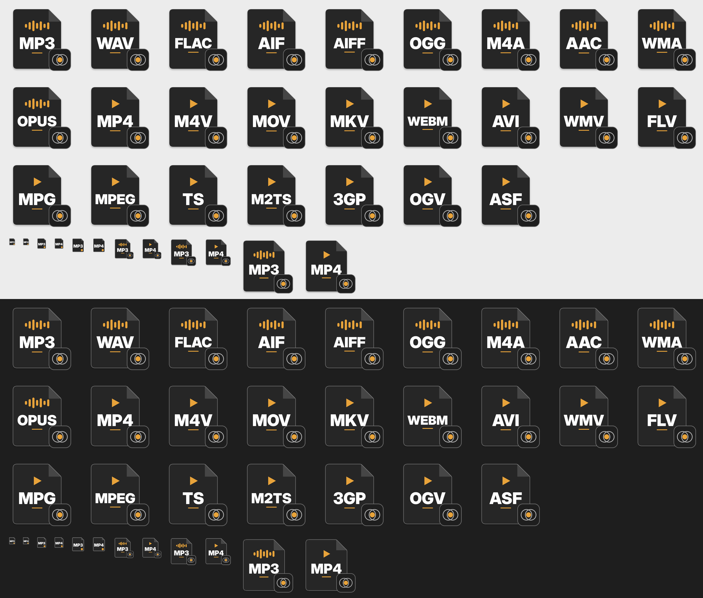

File-type icons.

- Every file type Transport plays gets its own icon: the type in big letters (MP3, WAV, FLAC, MP4, MOV, ...), a waveform or play mark, and the Transport logo small in the corner. A light rim keeps them readable in both light and dark mode, and the small sizes (16–32 px) use a simpler, bolder layout.
- **macOS:** the icons ship inside the app. Finder shows them for files that open with Transport (Get Info → Open with → Transport → Change All…, or MENU → Set as default audio player).
- **Windows:** the icons are built into the `.exe`. Each type is registered separately, so Explorer shows the matching icon once Transport is the default for that type (MENU → Set as default audio player, then confirm in Settings). If Transport was registered by an earlier version, it refreshes the registration on start. Choose Transport once more in Default Apps to switch to the new per-type icons.

